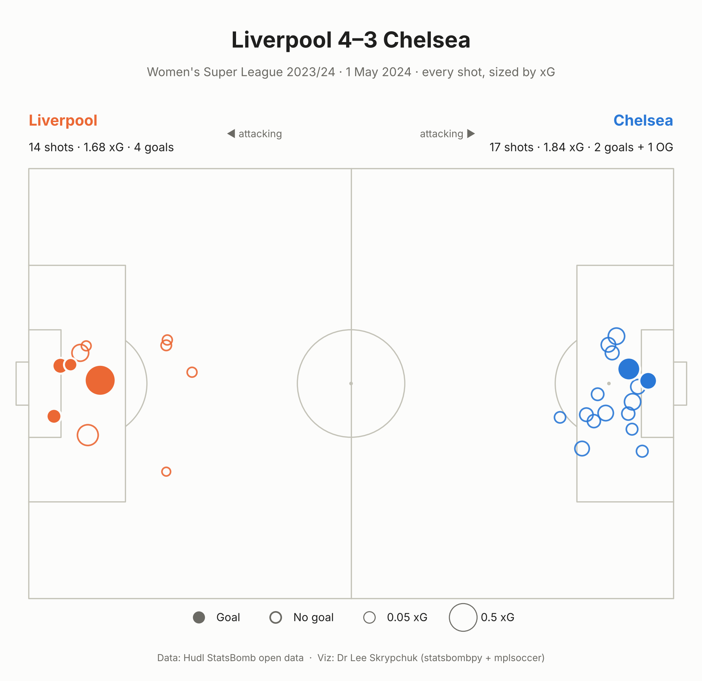

# 00 · First shot map

My first plot with StatsBomb open data: every shot in **Liverpool 4–3 Chelsea** (Women's Super League, 1 May 2024), sized by xG.



The xG was close (Chelsea 1.84, Liverpool 1.68), and Chelsea had more shots (17 v 14). Liverpool were far more clinical, and the biggest chance of the game went in. Chelsea's third goal was a Liverpool own goal, which StatsBomb doesn't record as a shot.

```bash
python analyses/00-first-shot-map/shot_map.py
```

<sub>Data: Hudl StatsBomb open data.</sub>
