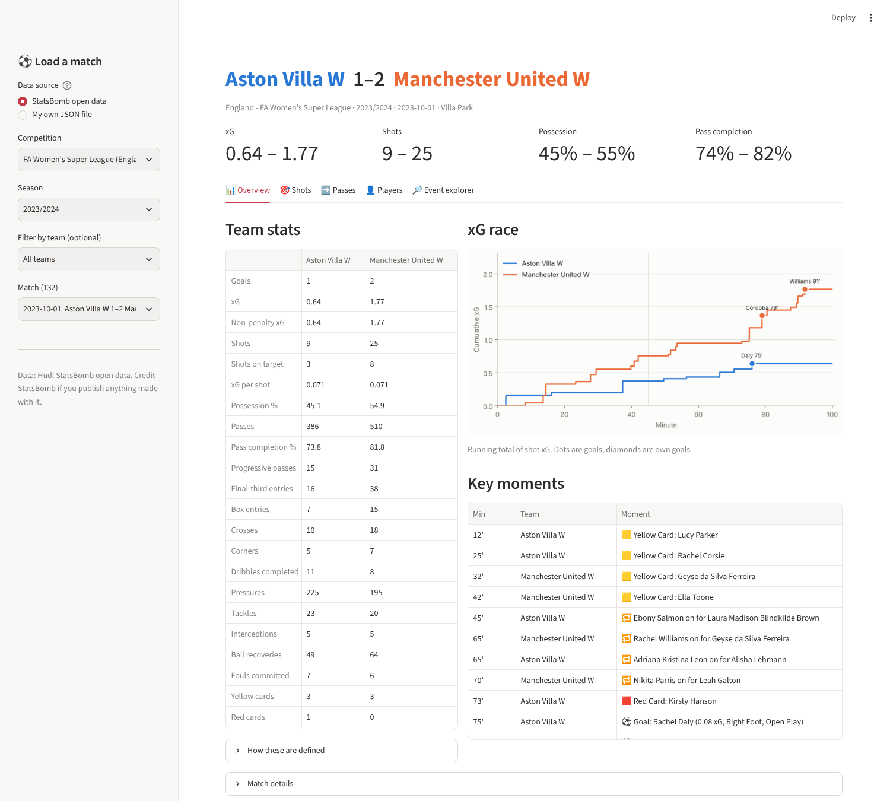

# StatsBomb Match Explorer

A point-and-click app for interrogating a single match of StatsBomb event data.



## Run it

From the repo root, with the virtual environment active:

```bash
pip install -r requirements.txt
streamlit run apps/match_explorer/app.py
```

Your browser opens at `http://localhost:8501`.

## Loading a match

In the sidebar, choose a data source:

- **StatsBomb open data**: pick a competition, season and match (with an optional team filter). The data is fetched from StatsBomb's public GitHub and cached, so switching back to a match is instant. The app opens on the Women's Super League.
- **My own JSON file**: upload a StatsBomb **events** file (e.g. `data/events/3913173.json` from the [open-data repo](https://github.com/statsbomb/open-data)), plus the matching **lineups** file if you have it. Team names and score are worked out from the events.

## What you can do

| Tab | What it shows |
|---|---|
| **Overview** | Side-by-side team stats (xG, shots, possession, progressive passes, box entries, pressures, tackles, cards…), an xG race chart, and a timeline of goals, cards and substitutions |
| **Shots** | Shot map for both teams (sized by xG, filled = goal), filter by team, player, outcome or penalties; where shots ended up in the goal; sortable shot table with CSV download |
| **Passes** | Pass map by team or player, filtered by type (progressive, into final third, into the box, key passes, crosses, set pieces, open play), outcome, pressure and minute range; most common passing combinations; **pass network** up to the first substitution |
| **Players** | Player table with minutes, touches, passing, xG, xA, dribbles and defensive actions, with a per-90 toggle and CSV download; pick one player for a touch heatmap, action map and pass map |
| **Event explorer** | Every event in the match: filter by type, team, player, period, minute and pressure, choose columns, download as CSV |

## Definitions

- **Possession %**: share of in-play time. Each event's time runs to the next event and is credited to the team in possession; stoppages longer than 20 s are capped.
- **Progressive pass**: completed open-play pass that starts outside the team's own 40% and moves the ball at least 25% closer to the centre of the goal.
- **Box entry**: completed pass from outside the penalty area that ends inside it.
- **xA**: the xG of the shot each pass set up, credited to the passer.
- **Shots and xG** leave out any penalty shoot-out. **Goals** include own goals.
- **Minutes** come from the starting XI, substitutions and red cards.

All pitch plots use StatsBomb's 120 × 80 coordinates, with each team attacking left to right.

## Code layout

| File | Role |
|---|---|
| `app.py` | The Streamlit interface |
| `data.py` | Loads open data with statsbombpy, or flattens an uploaded JSON into the same columns |
| `metrics.py` | Team, player, xG timeline and pass-network calculations |
| `plots.py` | mplsoccer / matplotlib figures |

`metrics.py` and `data.py` don't depend on Streamlit, so you can import them in a notebook.

---

<sub>Data: Hudl StatsBomb open data. Credit StatsBomb if you publish anything made with it.</sub>
